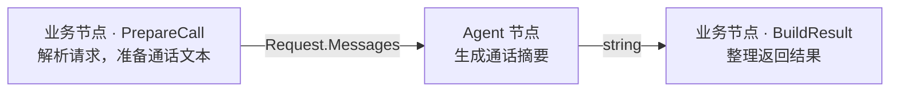
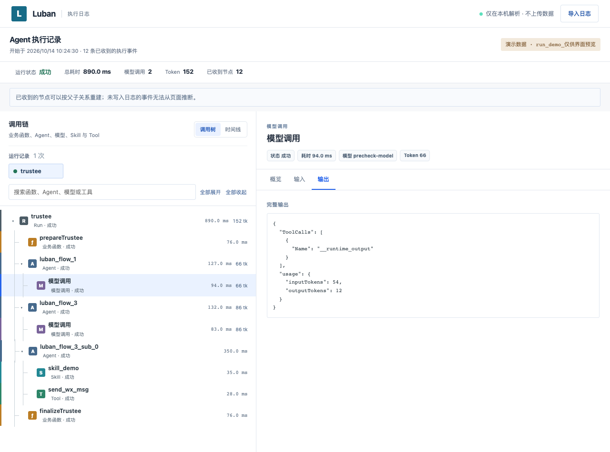

# 鲁班（Luban）

**让 Go 研发用一份配置和必要的业务函数，快速构建 Agent。**

基于 Eino，把模型调用、Tool、Skill 和节点传值整理成统一写法。业务专注取数、领域规则和结果处理，常见流程无需直接编写 Eino 编排代码。

> 开发中，尚未发布正式版本；许可证将在首次正式发布前确定。模块：`github.com/lubanAgent/luban/sdk`，包名：`luban`，需要 Go 1.24.1 或更高版本。

[快速接入](docs/快速接入.md) · [Eino / Luban 同需求对照](docs/Eino与Luban对照.md) · [变更记录](CHANGELOG.md) · [参与开发](CONTRIBUTING.md)

## 看一个通话摘要

一套 Agent 配置中的 `flow` 按顺序执行，两种节点分别负责业务逻辑和 AI 处理：



下面就是这个流程的配置。`func` 对应注册的业务函数，`modelName` 对应接入的模型调用器：

```json
{
  "callSummary": {
    "flow": [
      { "func": "PrepareCall" },
      { "modelName": "demo", "systemPrompt": "用一句话总结通话中的诉求和后续安排。" },
      { "func": "BuildResult" }
    ]
  }
}
```

固定指令放在 `systemPrompt`；每次请求的通话文本，由 `PrepareCall` 返回的 `Request.Messages` 提供。业务按需注册 Tool 和 Skill，在 Agent 节点的 `tools`、`skills` 中引用即可。

## 直接运行

在包含 SDK 源码的仓库检出目录运行：

```sh
cd sdk
go run ./examples/call-summary
```

不需要模型密钥、数据库或业务服务。首次安装 Go 依赖可能需要联网；示例执行不请求外部服务，使用模拟模型返回固定摘要：

```text
模式：模拟模型，不访问外部服务
输入：{"text":"客户：想了解周末的课程。顾问：明天下午发课程安排，再电话确认。"}
输出：{"summary":"客户想了解周末课程，顾问将于明天下午发送课程安排并电话确认。"}
```

这个例子真实执行了 **JSON 加载 → 初始化注册 → Gin 路由 → SDK Handler → 三个节点 → JSON 响应**，默认通过内存 HTTP 请求运行，不监听端口。它不代表真实模型的摘要质量，也不读写数据库。

[查看完整示例](sdk/examples/call-summary/main.go) · [配置文件](sdk/examples/call-summary/agent.json) · [模拟模型](sdk/examples/call-summary/model.go)

## 接入自己的项目

| 时机 | 业务需要做什么 |
| --- | --- |
| 定义流程 | 写 Agent 配置和必要的业务函数，按需提供 Tool、Skill。 |
| 启动时 | 加载 JSON，提供模型调用器，调用 `New` 和 `Register`。 |
| 绑定入口 | 把 SDK Handler 注册到现有 HTTP、MQ 或 Cron 入口。 |
| 收到任务 | SDK 按配置执行；业务函数负责取数、校验、保存或其他业务动作。 |

例如，初始化完成后，在已有 Gin 路由中绑定：

```go
router.POST("/summary", lubanhttp.Handler(rt, "callSummary", render))
```

Handler 内部执行 `Run`。首节点解析请求，末节点返回结果，业务的 `render` 决定接口响应格式。MQ 和 Cron 也有对应适配器。

模型通过业务实现的 `ModelInvoker` 接入：业务负责现有网关的 HTTP、鉴权、超时、重试和协议转换；Luban 负责 Agent 循环、Tool/Skill 调用和节点传值。SDK 不内置厂商 HTTP 客户端，也不依赖公司内部包。

**[按步骤接入：完整代码、函数约定、模型替换、HTTP/MQ/Cron](docs/快速接入.md)**

## 为什么使用 Luban

将团队常用的做法统一下来，新增类似需求时可以沿用：

- **流程写法固定**：一份 JSON 排列节点，函数、模型、Tool、Skill 显式登记后按名称引用。
- **传值规则固定**：前一步返回值交给后一步；需要模型提交结构体时声明 `Output[T]()`。
- **接入方式固定**：复用已有网关和 Gin 业务函数，通过 SDK Handler 接入 HTTP、MQ、Cron，执行事件交给同一个 TraceWriter。

直接用 Eino 也能简洁完成一次模型调用。Luban 的价值是提供这套可复用的约定，让业务少做重复装配和选型；同时接受顺序 flow 等边界。[运行同一个通话摘要，对照两边完整代码](docs/Eino与Luban对照.md)。

## 看见每一步执行

业务实现可选的 `TraceWriter`，把执行事件写入自己的日志。将同一次 `runId` 的日志导入本地查看页，即可查看调用树、耗时和节点输入输出。



*上图来自查看页自带的模拟演示数据，用于展示包含 Tool、Skill、子 Agent 的流程；不是上方通话摘要示例的运行结果。*

从源码目录在本机打开 [Trace 查看页](sdk/trace-viewer/index.html)，点击“查看演示数据”即可体验。页面在本机解析，不需要部署服务；日志可能含业务内容。[Trace 接入与查看说明](sdk/trace-viewer/README.md)。

## 能力与边界

| 能力 | 当前支持 |
| --- | --- |
| Agent 流程 | 顺序连接业务节点和 Agent 节点；外层 flow 无配置分支或回跳，Agent 内可多轮调用工具。 |
| 模型与 Tool | 各 Agent 独立配置模型、提示词、温度和 `maxLoopCount`；使用已注册 Tool 白名单。当前不支持实时流式输出。 |
| Skill | 注册静态正文，或由业务 `SkillBackend` 提供；Agent 按需加载。 |
| 子 Agent | 父选择并移交一个子 Agent；子使用自己的模型、提示词、Tool、Skill。一层移交，不返回父 Agent 重写答案。 |
| 返回值 | 默认传递模型原始字符串；声明 `Output[T]()` 后，模型通过内部 OutputTool 提交结构化结果。 |
| Batch | 并发处理多条输入，按原下标收集结果和错误。 |
| 跨节点数据 | `luban.Set/Get` 在一次 Run 内共享数据，普通 Tool 可读写；Batch 只读公共快照，结束后清理。 |
| 提前结束 | flow 业务函数调用 `Stop(ctx)` 后显式 return；Tool 调用 Stop 返回执行错误。 |
| Trace | 执行事件与本地查看页；没有远端 Trace 服务。 |

适合已有 Go/Gin 业务和模型调用器，希望用统一写法组织 AI 流程的项目。当前没有跨请求暂停恢复、远端配置平台；媒体和 Tool Calling 能力取决于接入的模型与网关。

## 文档与参与

- [快速接入](docs/快速接入.md)：从 JSON 配置到业务入口，以及 Tool、Skill、Output、Batch、Stop 等进阶索引。
- [Eino 与 Luban 对照](docs/Eino与Luban对照.md)：相同输入、模拟回复和 HTTP 输出，完整展示两种实现。
- [Trace 查看页说明](sdk/trace-viewer/README.md)：日志格式、用量来源和调用树。
- [参与开发](CONTRIBUTING.md)：开发环境、验证和贡献约定。

欢迎通过 Issue 提供接入场景、最小复现和建议。在仓库根目录运行 `make check-sdk`，检查格式、依赖、测试、竞态、`go vet` 和公司包依赖边界，并校验两份示例输出。修改查看页时另运行 `node --test sdk/trace-viewer/trace-data.test.js`。
