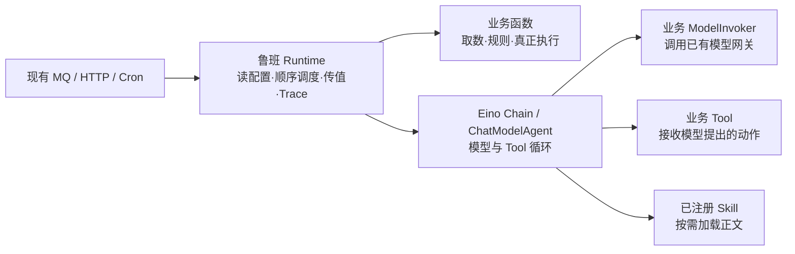
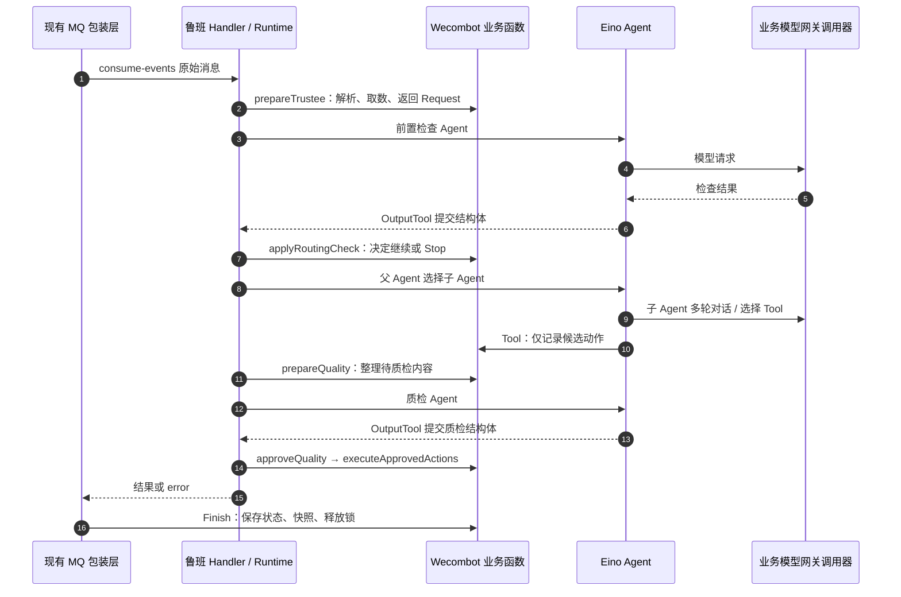

# 鲁班框架：当前怎么运行，业务怎么接入

> 以当前 SDK 和 Wecombot 的 `trustee` Agent 为准。建议先看两张图，再顺着下面的四段代码回到源码。

## 先用半分钟讲明白

业务在**启动时**把一套 Agent 配置、真实 Go 函数、Tool、Skill 和模型网关调用器交给鲁班。**消息到来时**，鲁班按配置依次调用业务函数和 Agent 节点；Agent 节点内部借助 Eino 让模型选择 Skill/Tool。取数、质检规则、真正发送消息和 MQ 收尾仍由业务负责。Wecombot 的一次 `consume-events` 消息只进入**一次** `Run(ctx, "trustee", message)`。



这里的关键分界：**鲁班决定节点连接与调用，Eino 执行模型/Tool 循环，业务调用器实际发模型 HTTP 请求。** 鲁班自身没有为业务另开 MQ 或 HTTP 监听。

## 1. 框架当前如何实现

| 发生在什么时候 | 鲁班做什么 | 业务做什么 |
| --- | --- | --- |
| 启动 | `New` 复制配置与模型映射；`Register` 检查并登记函数、Tool、Skill | 加载 JSON，创建业务 `Worker`，交出函数 map、Tool、Skill、`ModelInvoker` |
| 每次 `Run` | 按 `appKey` 取配置快照，校验流程，**本次临时**编译 Eino Chain | 入口把本次原始消息交给 SDK |
| 函数节点 | 用反射校验/调用签名，把**紧邻上一步**的输出传给下一步 | 写取数、规则、持久化等不可替代的逻辑 |
| Agent 节点 | 把 `Request.Messages` 交给 Eino；接入模型、Tool、Skill、循环上限 | 提供动态消息、模型网关调用器、Tool 实现 |
| 结束 | 正常交付最后节点结果；`Stop` 结束后续节点；失败返回 error；可写 Trace | HTTP 渲染结果或 MQ 收尾、重试 |

业务函数形如 `func(ctx *gin.Context, input T) (R, error)`：首参 Gin 必须有，最多一个业务输入和一个业务输出，末尾 error 可选。相邻节点只按 Go 类型可赋值规则传递；没有输出，不会偷偷透传旧数据。`Stop(ctx)` 要在业务函数里调用，随后业务函数正常 `return`。错误时 `Run` 返回 `nil, error`。

Agent 节点前面的函数返回 `luban.Request`：`Messages` 放这一次的文本/图片等动态输入；节点配置里的 `systemPrompt` 放固定指令。若设置 `Output: luban.Output[T]()`，SDK 增加内部 OutputTool，成功提交后下一函数收到 `T`；不设置则收到模型的原始文本。父 Agent 只负责选择并移交子 Agent，子 Agent 有自己的模型、提示词、Tool/Skill 和循环上限。

## 2. Wecombot 怎么接入

启动接入只看这四处：

1. [`conf/mount/luban_agents.json`](/Users/chaijinyang/go/src/虾宝平台迁移项目/wecombot/conf/mount/luban_agents.json)：顶层 `trustee` 是一套 Agent，`flow` 是顺序节点。业务资源另在 `luban_resources.json`，Skill 正文由 `LubanSkills` 提供。
2. [`service/trustee_agent/config.go`](/Users/chaijinyang/go/src/虾宝平台迁移项目/wecombot/service/trustee_agent/config.go)：`Functions()` 把 `func` 名字映射到真实方法；`Tools()`、`Models()` 给出工具与模型网关调用器。
3. [`router/airuntime.go`](/Users/chaijinyang/go/src/虾宝平台迁移项目/wecombot/router/airuntime.go)：创建 `Worker`，调用 `luban.New(...)`、`rt.Register(...)`；启动时**不跑模型**。
4. [`router/mq.go`](/Users/chaijinyang/go/src/虾宝平台迁移项目/wecombot/router/mq.go)：现有 MQ 注册表里绑定 `"consume-events": lubanmq.Handler[rmq.Message](rt, "trustee")`。业务没有再写一层手动 `Run`。

下面是接入的**缩略形状**，具体参数以源码为准：

```go
worker, _ := trustee_agent.New(conf.LubanAgents, conf.LubanResources, conf.LubanSkills, nil)
rt, _ := luban.New(luban.Options{
    Config: conf.LubanAgents,
    Models: worker.Models(conf.LubanAgents), // 模型请求实际由业务网关代码发送
    TraceWriter: lubanTraceWriter{},        // 可选：写现有日志
})
_ = rt.Register(worker.Functions(), worker.Tools(), conf.LubanSkills)

// 现有消费服务的 handler 注册表：
"consume-events": lubanmq.Handler[rmq.Message](rt, "trustee")
```

实际的 `Functions()` 例如 `"prepareTrustee": w.prepareTrustee`。模型 Tool 则实现 `Name()`、`Description()`、`Input()`、`Invoke(*gin.Context, any)`；**注册表示框架能找到它，配置中 `tools` 才决定本节点是否开放给模型**。Skill 同理，在配置中列出可用名称，正文按需载入。

## 3. 顺着一条真实消息讲



这张图压缩了中间交互，准确的 8 个节点是：`prepareTrustee → 前置检查 Agent → applyRoutingCheck → 父/子 Agent 节点 → prepareQuality → 质检 Agent → approveQuality → executeApprovedActions`。**`send_wx_msg` Tool 此处只记录候选，不立即发消息**；审核通过后才执行。当前质检失败不重新选择子 Agent。前置检查或质检决定 `Stop` 时，后续节点跳过，但外层 `Finish` 仍运行。

## 4. 汇报时最容易说错的五句话

- “配置里有多个 Agent，所以要 Run 多次”——当前 `trustee` 是**一套配置、一次 Run**；父选子发生在其中一个节点内部。
- “鲁班帮业务发模型 HTTP”——鲁班提供模型接口及适配，**Wecombot 的 `ModelInvoker`** 才调用已有网关。
- “Tool 调用成功就发给家长了”——此 Case 的 Tool 只收候选；质检和业务检查通过后再执行。
- “Run 会把所有中间结果存起来”——相邻节点传值，业务本轮共享状态可放 Gin Context；每次 Run 编译 Chain，Trace 可选写业务日志。
- “从第二个入口 RunFrom 就自动恢复上次会话”——`RunFrom` 可从指定业务函数节点开始，**不恢复**前次 Run 的状态，调用方提供本次输入。

可选的 `TraceWriter` 在本 Case 写 `luban_trace` 日志并带 `runId`；离线页面位于 [`sdk/trace-viewer/index.html`](../sdk/trace-viewer/index.html)。SDK 另有 HTTP `Handler`（业务提供 Renderer）与 Cron `Job`（业务提供 Loader、逐项 Run），核心 Runtime 不变。

**源码起点：** [`sdk/run.go`](../sdk/run.go) 看每次 Run；[`sdk/internal/eino/chain.go`](../sdk/internal/eino/chain.go) 看 Chain；[`sdk/internal/eino/agent.go`](../sdk/internal/eino/agent.go) 看 Agent/Tool/Skill；[`LUBAN_GUIDE.md`](/Users/chaijinyang/go/src/虾宝平台迁移项目/wecombot/LUBAN_GUIDE.md) 是业务项目的逐文件阅读索引。
